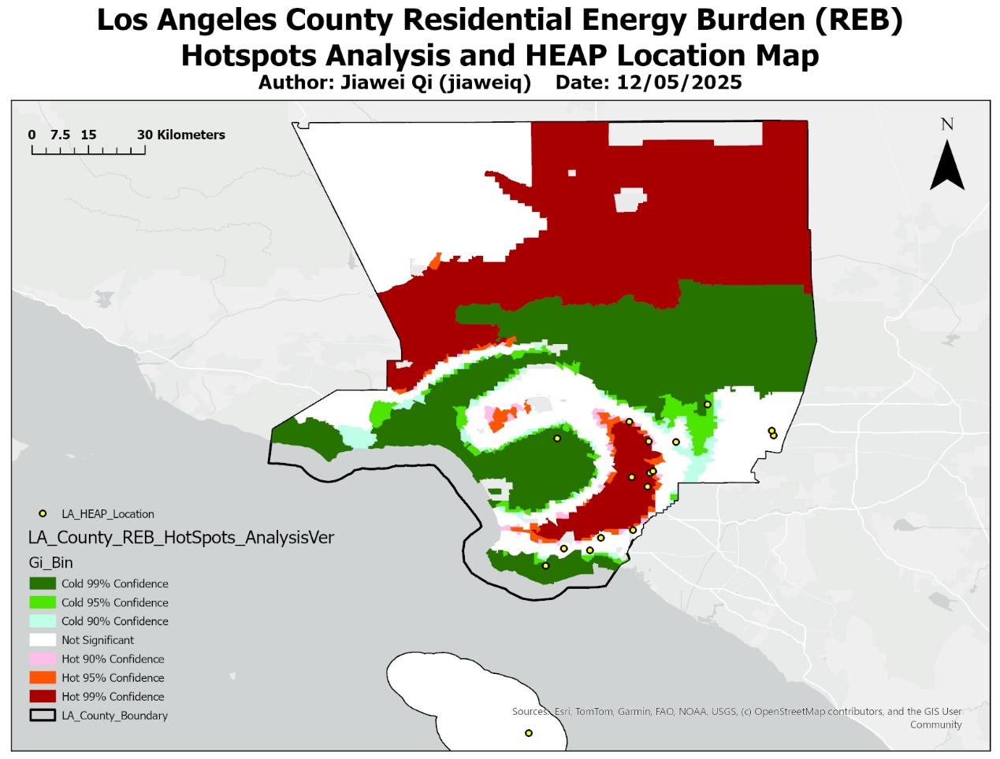
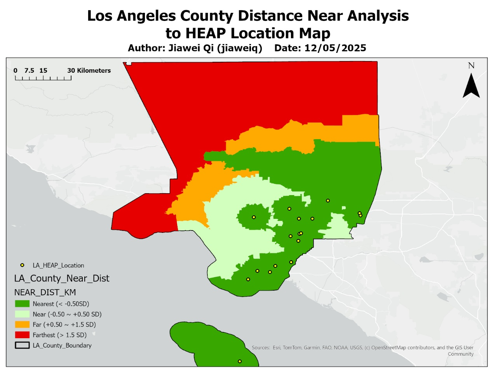

# Spatial Inequities in Residential Energy Burden and HEAP Service Accessibility

A census-tract GIS analysis of where household energy burden clusters in Los Angeles County and how far those communities are from energy assistance (HEAP/LIHEAP) centers.

*Academic project, Carnegie Mellon University, Fall 2025.* Full write-up: [`report/LA_County_Energy_Burden_Report.pdf`](report/LA_County_Energy_Burden_Report.pdf)



## Key findings

- **Energy burden is clustered, not random.** Getis-Ord Gi* finds significant high-burden hot spots in the Antelope Valley, south of the Santa Clarita Valley and in Central Los Angeles, forming a crescent that extends inland from the urban core. Cold spots lie along the coast and in affluent areas such as Malibu and Beverly Hills.
- **Hot spots are a distinct burden regime.** Moving from the strongest cold spots to the strongest hot spots, both the level and the spread of energy burden rise.
- **Distance to assistance is only part of the story.** HEAP centers cluster in the Los Angeles Basin, so many urban hot spots are close to help. The northern periphery is the one area that is both high-burden and far from any center.
- Across the 2,437 tracts analysed, low-income households carry about twice the average energy burden (3.9% vs. 2.0% of income).

## Method

1. Joined tract-level energy burden (USC NDSC), ACS 2023 median income, tenure and housing age, and TIGER/Line 2023 tract boundaries in ArcGIS Pro, projected to NAD 1983 (2011) StatePlane California V.
2. Cleaned the joined table in Python: removed ACS error codes and invalid values, fixed numeric types, and derived the renter and old-housing percentages (2,498 tracts in, 2,437 out).
3. Ran Hot Spot Analysis (Getis-Ord Gi*) on residential energy burden.
4. Geocoded HEAP/LIHEAP application centers and used the Near tool to measure the straight-line distance from each tract centroid to the nearest center, classified by standard deviation.



## Repository contents

| Path | Contents |
|---|---|
| `report/LA_County_Energy_Burden_Report.pdf` | Project report |
| `figures/` | The two map layouts from the report |
| `analysis/clean_tract_data.py` | Cleaning script: `LA_County_Full_Table.xlsx` (joined table exported from ArcGIS Pro) to `LA_County_Cleansed.xlsx` |
| `analysis/LA_County_Full_Table.xlsx`, `analysis/LA_County_Cleansed.xlsx` | Input and output of the cleaning step, one row per census tract |

To re-run the cleaning step:

```bash
cd analysis
pip install -r requirements.txt
python clean_tract_data.py
```

## Data sources

- Residential energy burden: USC Lusk Neighborhood Data for Social Change, [la.myneighborhooddata.org](https://la.myneighborhooddata.org/2023/03/energy-burden)
- Median household income (B19013), tenure (B25003) and year structure built (B25034): U.S. Census Bureau, ACS 2023 5-year estimates, [data.census.gov](https://data.census.gov)
- Census tract boundaries: U.S. Census Bureau, [TIGER/Line 2023](https://www2.census.gov/geo/tiger/TIGER2023/TRACT/)
- HEAP/LIHEAP center locations: program listings from the Long Beach Community Action Partnership and the Pacific Asian Consortium in Employment, geocoded in ArcGIS Pro
- Basemap: Esri and its data partners

## Notes

- The ArcGIS Pro project files are not included; the maps are exported layouts.
- Energy burden values are NDSC's 2020 estimates for nearly all tracts (2018 for six).
- Distances were classified by standard deviation, so the classes do not depend on units. The legend field `NEAR_DIST_KM` was computed from StatePlane US feet divided by 1,000, so its raw values are thousands of feet rather than kilometres; the map's scale bar is correct.
